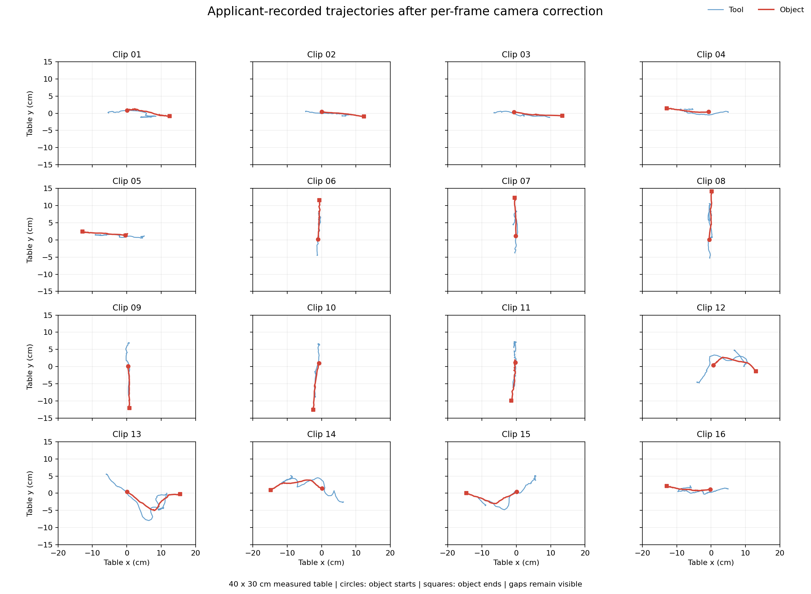
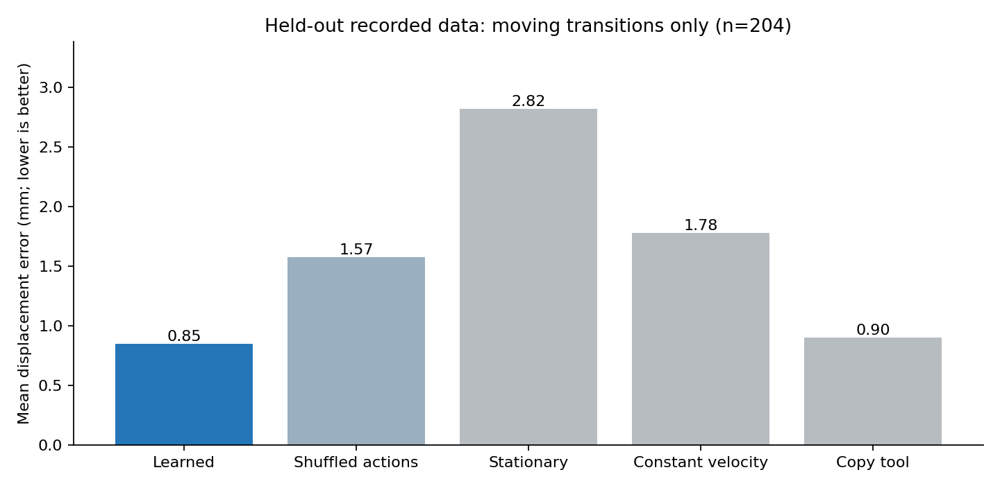

# Phone2Sim

**Phone-recorded pushing → action-conditioned state dynamics → a physical two-joint MuJoCo arm.**

A small, inspectable robot-learning experiment using 16 personally recorded human pushing demonstrations. The model predicts object displacement from object/tool state and candidate tool displacement. A controller uses those predictions to follow demonstrated object paths with a different embodiment.

This implementation uses nearest-neighbour state dynamics and a hand-written contact planner. It does not fine-tune a VLA or train a generative video model. Recording authorship and independence are applicant-declared.

[Detailed results and limitations](docs/RESULTS.md) · [Experiment scope](docs/CHALLENGE.md)

## Results

Twelve source recordings train the model; four recordings are held out (seed 7). Evaluation uses four test paths × three reset seeds × three physical conditions × three controllers = **108 rollouts**.

| Controller | Nominal | Velocity impulse | Higher friction | Mean final error |
|---|---:|---:|---:|---:|
| Tool-trajectory replay | 0/12 | 0/12 | 0/12 | 84.64 mm |
| Geometric feedback | 12/12 | 12/12 | 12/12 | 10.64 mm |
| Learned-model feedback | 12/12 | 12/12 | 12/12 | 7.36 mm |

Both feedback methods succeed on every evaluated case. These counts do not establish a success-rate advantage for learning. On 204 moving held-out transitions, prediction error is 0.85 mm, compared with 1.57 mm after action shuffling and 0.90 mm for copying tool displacement. The advantage over tool-copy is small; these are errors against extracted tracks, not independently measured physical accuracy.





## Examples and artifacts

[Real recorded pushing example](examples/recorded_push.mp4) · [The same recording with tracking overlay](examples/tracking_push.mp4) · [Recording provenance](examples/README.md)

The same preselected test case is saved for all three methods; failed replay is retained. These videos are simulation, not real-robot footage:

- [Replay failure](runs/real_20261022_v1/replay_impulse.mp4)
- [Geometric feedback](runs/real_20261022_v1/geometry_impulse.mp4)
- [Learned feedback](runs/real_20261022_v1/learned_impulse.mp4)
- [Readable report](runs/real_20261022_v1/report.md), [HTML report](runs/real_20261022_v1/report.html) — open the HTML locally after downloading/cloning.
- [Exact split, input hashes and versions](runs/real_20261022_v1/manifest.json)
- [All 108 rollout measurements](runs/real_20261022_v1/rollouts.json); per-rollout arrays are `trace_*.npz` in the same directory.
- [Processed data summary](data/processed/collection_20261021_v1/dataset_summary.json); model files are included with the run.

## Reproduce

Tested with Python 3.12 on Windows. Physics and the small state model run on CPU. From this repository's root, use a fresh output directory:

```powershell
py -3.12 -m venv .venv
.\.venv\Scripts\python.exe -m pip install -r requirements-lock.txt
.\.venv\Scripts\python.exe -m pip install -e . --no-deps
.\.venv\Scripts\python.exe -m pytest -q
.\.venv\Scripts\python.exe -m phone2sim train --data data/processed/collection_20261021_v1 --out runs/reproduction_01 --seed 7
.\.venv\Scripts\python.exe -m phone2sim evaluate --data data/processed/collection_20261021_v1 --run runs/reproduction_01 --seeds 3
.\.venv\Scripts\python.exe -m phone2sim audit --data data/processed/collection_20261021_v1 --run runs/reproduction_01
.\.venv\Scripts\python.exe scripts/plot_collection.py --run runs/reproduction_01
```

Open `runs/reproduction_01/report.html` locally. Rendering requires a usable graphics context; `--no-video` runs physics evaluation without rendering. Twenty tests cover tracking, rejected camera fits, missing observations, geometry, source splits, contact and provenance integrity.

## Data flow

1. Locate red-object and blue-tool centres, compensate for phone motion with background ORB/RANSAC (SIFT fallback), and map to a measured 40 × 30 cm table plane.
2. Sample at 10 Hz. There are 2,060 times, four with short missing observations. Short fills keep replay paths continuous; transitions touching fills are excluded from learning/scoring. All 16 takes passed QA.
3. Express tool/object state and displacement in an action-aligned frame. A weighted 12-neighbour model predicts object displacement; a hand-written swept-contact gate constrains predictions.
4. Use held-out object paths as supplied goals. A shared contact approach planner repositions the tool; learned control ranks 36 candidate motions during contact.
5. Convert tool targets to two joint angles using analytic inverse kinematics. MuJoCo servos/contact dynamics execute motion without overwriting object positions during control.

Recorded-data dimensions are 23.5 mm for the measured tool diameter and 45 mm for the image-estimated object diameter. Simulator mass/friction are assumptions. Original footage and interior-background tracking overlays are retained privately; the processed trajectories, hashes, model and results needed to rerun state-model training and simulation are included. This release does **not** independently reproduce or verify pixel extraction without the originals and local intake calibration files.

## Limitations

All recordings share one session, object and scene. The four held-out paths are near-straight; curves happen to be in training. The simulator supplies exact state, the disturbance is mild, and only four independent test references are available. Shared planning, inverse kinematics and support rules are substantial hand-written components. There is no language conditioning, grasping, general visual policy or real-robot deployment. See [the full analysis](docs/RESULTS.md) for failures, calibration uncertainty and next experiments.

This project is a recorded-data prototype/portfolio experiment. Publishing a repository is separate from submitting a recruiting application. No open-source license has been selected for this snapshot.

## References

- [MuJoCo Python API](https://mujoco.readthedocs.io/en/stable/python.html)
- [OpenCV calibration and perspective transforms](https://docs.opencv.org/4.x/d9/d0c/group__calib3d.html)
- [OpenCV colour thresholding](https://docs.opencv.org/4.x/da/d97/tutorial_threshold_inRange.html)
